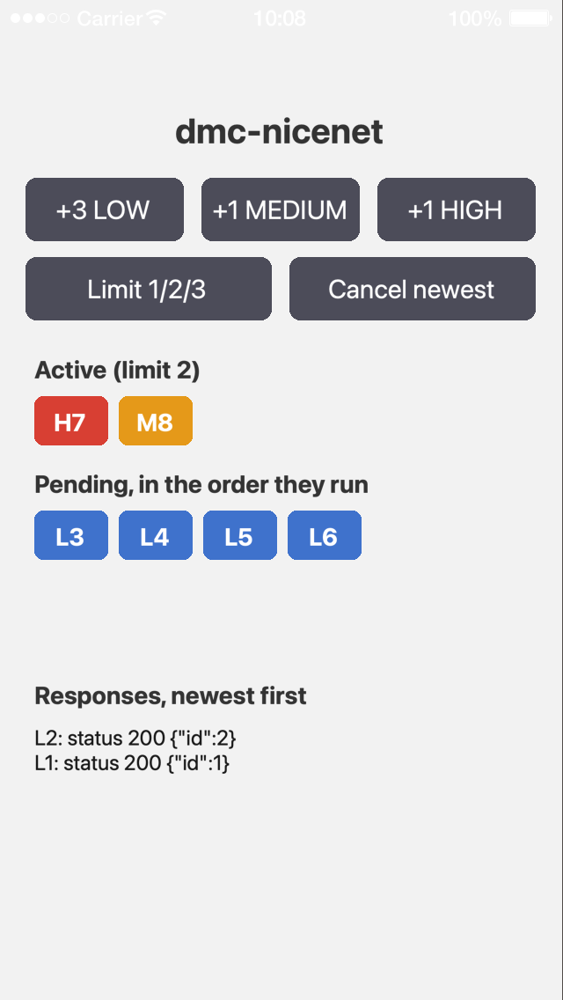

# Examples

Each folder is a complete Solar2D project with its own copy of the library: open its `main.lua` in the Solar2D Simulator.

| | |
|---|---|
|  | **dmc-nicenet-queue**: add requests at each priority and watch the queue run them, two at a time: the colored chips are the calls running and waiting, in the order they'll run, and a HIGH or MEDIUM call goes ahead of the waiting LOW ones. Cancel newest cancels the last call not yet done; Limit cycles the calls run at once through 1, 2 and 3. A [dmc-mockserver](https://github.com/dmccuskey/dmc-mockserver) mock server answers each request after 2 s, so the app runs offline; it's set up at the top of `main.lua`. |
